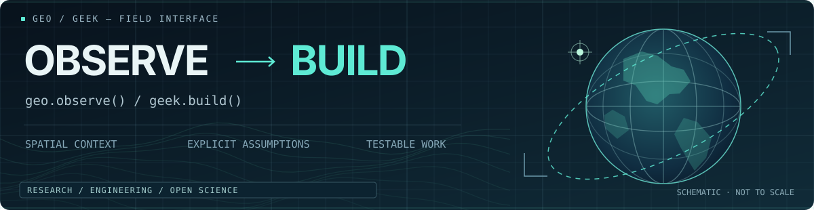

<!-- GEOGEEK / GitHub profile -->
<h1 align="center">GEOGEEK</h1>

<p align="center">
  <strong>Geo to see. Geek to build.</strong>
</p>

<p align="center">
  
</p>

<p align="center">
  <strong>Open · Taste · Respect · Respond</strong>
</p>

<p align="center">
  <a href="https://geogeeklab.github.io/">Website</a> ·
  <a href="https://geogeeklab.github.io/field-notes.html">Field Notes</a> ·
  <a href="https://geogeeklab.github.io/lab.html">Lab</a> ·
  <a href="https://geogeeklab.github.io/atlas.html">Atlas</a> ·
  <a href="https://geogeeklab.github.io/origin/en/">Origin</a>
</p>

---

## `01 / PRACTICE`

| **AI Native** | **Geospatial Engineering** | **Open Science** |
| :--- | :--- | :--- |
| `METHOD` | `FIELD` | `PRINCIPLE` |
| Use AI within research and engineering workflows. Verify the output, not just the execution. | Build tools for spatial data, Earth observation, geographic reasoning, and reproducible computation. | Make assumptions, evidence, methods, and limitations inspectable. Share work that others can test and improve. |

I work with **geographic questions** and **engineering methods**. A model is not a measurement; a visualization is not evidence; a passing test is not proof of geographic correctness.

## `02 / RESEARCH LOOP`

```text
observation → question → model → validation → tool
     ↑                                 │
     └────────── revision ─────────────┘
```

A useful result must carry its context: **where**, **when**, **at what scale**, **under which assumptions**, and **with what uncertainty**. The goal is not a more convincing picture; it is a more inspectable understanding.

## `03 / GEO · OBSERVE`

Spatial instruments and interactive experiments. Each starts with a geographic question.

| Instrument | What it helps examine |
| :--- | :--- |
| [Orbital Commons](https://github.com/GeoGeekLab/orbital-commons) | Satellite orbits and their relation to places on Earth |
| [Earth in Change](https://github.com/GeoGeekLab/earth-in-change) | Earth imagery through acquisition time |
| [Geographic Flow Laboratory](https://github.com/GeoGeekLab/geographic-flow-lab) | Continuous flow, origin–destination networks, and trajectories |
| [Earth Pulse](https://github.com/GeoGeekLab/earth-pulse) | Earthquake events in space, depth, and time |
| [World as Relation](https://github.com/GeoGeekLab/world-as-relation) | What map projections preserve and distort |
| [Water as Spectrum](https://github.com/GeoGeekLab/water-as-spectrum) | Water optics, atmospheric effects, and remote-sensing retrieval |
| [Image → Trace](https://github.com/GeoGeekLab/image-to-trace) | Turning image geometry into inspectable traces |

## `04 / GEEK · BUILD`

Research and engineering tools. These focus on failure modes that a clean interface or a green check can hide.

| Tool | Engineering question |
| :--- | :--- |
| [GeoDebug](https://github.com/GeoGeekLab/geodebug) | Is the code correct **geographically**, not just syntactically? |
| [STAC Scout](https://github.com/GeoGeekLab/stac-scout) | Is the selected Earth-observation data appropriate and traceable? |
| [Nature Reviewer Skills](https://github.com/GeoGeekLab/nature-reviewer-skills) | Do scientific claims have discriminating evidence and clear limits? |
| [engineering-quality](https://github.com/GeoGeekLab/engineering-quality) | What evidence supports a claim that a code change works? |
| [awesome-tech-feeds](https://github.com/GeoGeekLab/awesome-tech-feeds) | How can useful technical signals be separated from noise? |

<details>
<summary><strong>05 / OUTSIDE THE LAB</strong> — The human side</summary>

<br />

**In motion:** lifting · photography · cooking · hiking  
**In thought:** philosophy · psychology · music

**In community:**
- Volunteer team lead — Third National Soil Survey, Guangdong
- Volunteer — [Guangzhou Marathon](http://en.guangzhou-marathon.com/)

</details>

---

<p align="center">
  <sub>IDENTITY</sub><br />
  <strong>Research Engineer</strong>
</p>
